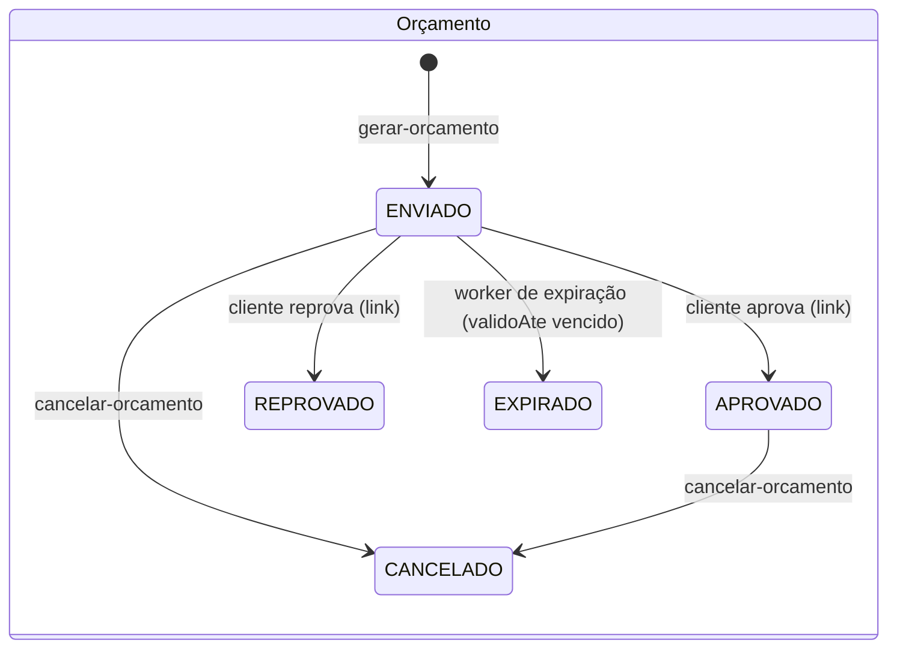
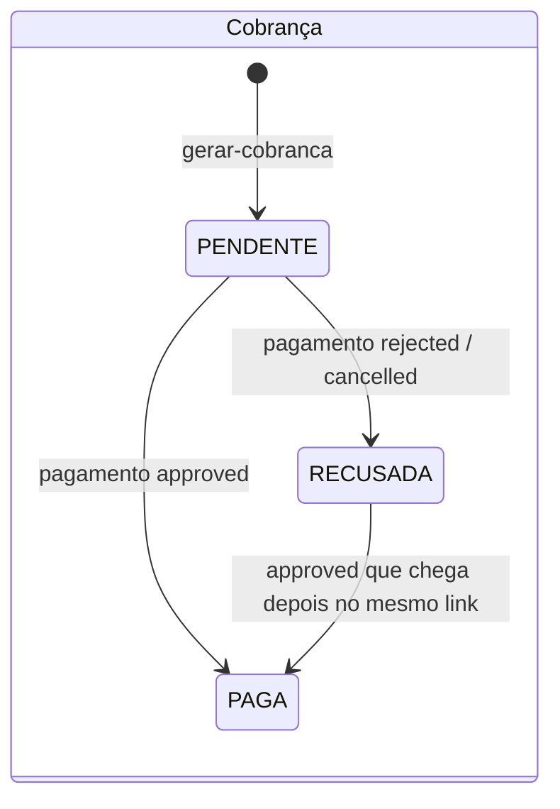

# tc-fase4-billing — Billing Service

[](https://sonarcloud.io/summary/new_code?id=Os-Desacoplados-Pos-Tech-SOAP-FIAP_tc-fase4-billing)
[](https://sonarcloud.io/summary/new_code?id=Os-Desacoplados-Pos-Tech-SOAP-FIAP_tc-fase4-billing)
[](https://sonarcloud.io/summary/new_code?id=Os-Desacoplados-Pos-Tech-SOAP-FIAP_tc-fase4-billing)
[](https://sonarcloud.io/summary/new_code?id=Os-Desacoplados-Pos-Tech-SOAP-FIAP_tc-fase4-billing)

Microsserviço do **orçamento, da aprovação pelo cliente e do pagamento** (Mercado Pago Checkout Pro) da OS.

Stack: NestJS 10, TypeScript, PostgreSQL 16, Prisma 5, SNS/SQS FIFO (AWS SDK v3), Pino, OpenTelemetry.

## Papel na saga

O Billing participa da saga orquestrada pelo OS Service em dois momentos:

1. **Antes do pivô (passos compensáveis).** `gerar-orcamento` cria o orçamento e envia ao cliente o link de
   aprovação (uso único). O cliente aprova ou reprova pelo link; sem resposta dentro da validade, o orçamento expira.
   Se a saga precisar desfazer o que já foi feito (ex.: reserva de insumos falhou ou execução recusada), o
   orquestrador manda `cancelar-orcamento` (compensação), que vale para orçamento `ENVIADO` ou `APROVADO`.
2. **Depois do pivô (OS finalizada).** `gerar-cobranca` cria a preferência no Mercado Pago e manda ao cliente o link
   de pagamento. A confirmação ou a recusa chega pelo webhook do Mercado Pago (ou pela rota de simulação em dev) e
   vira `pagamento-confirmado` ou `pagamento-recusado`. Depois de uma recusa, o orquestrador pode pedir um novo link
   com outro `gerar-cobranca`; a OS guarda o histórico das cobranças.





`REPROVADO`, `EXPIRADO` e `CANCELADO` são finais. Só um orçamento `APROVADO` pode ser cobrado; uma OS tem no
máximo uma cobrança `PENDENTE` por vez (índice único parcial no banco).

## Mensagens

Envelope padrão de todas as mensagens: `{ messageId, type, occurredAt, correlationId, causationId?, payload }`,
com `correlationId = osId`. O `correlationId` é o `MessageGroupId` FIFO, o que preserva a ordem da saga por OS.
Comandos chegam na fila `oficina-billing-inbox.fifo`; eventos saem no tópico `oficina-billing-events.fifo`.

| Recebe (comando) | Payload | Publica (evento) |
|---|---|---|
| `billing.gerar-orcamento.v1` | `{ numeroOs, cliente: { nome, email }, itens: [{ itemId, tipo: SERVICO \| INSUMO, referenciaId, descricao, quantidade, valorUnitario }] }` | `billing.orcamento-enviado.v1` |
| `billing.cancelar-orcamento.v1` — compensação | `{ motivo? }` | `billing.orcamento-cancelado.v1` (sempre, mesmo sem nada a cancelar) |
| `billing.gerar-cobranca.v1` — após a execução | `{}` (o valor vem do orçamento aprovado) | `billing.cobranca-gerada.v1` (ou `pagamento-confirmado` se a OS já estiver paga) |

| Evento | Payload | Quando |
|---|---|---|
| `billing.orcamento-enviado.v1` | `{ osId, orcamentoId, numeroOs, valorTotal, validoAte }` | orçamento criado e e-mail enviado ao cliente |
| `billing.orcamento-aprovado.v1` | `{ osId, orcamentoId }` | cliente aprovou pelo link |
| `billing.orcamento-reprovado.v1` | `{ osId, orcamentoId }` | cliente reprovou pelo link |
| `billing.orcamento-expirado.v1` | `{ osId, orcamentoId }` | validade vencida sem resposta (a saga trata como reprovação) |
| `billing.orcamento-cancelado.v1` | `{ osId }` | resposta à compensação |
| `billing.cobranca-gerada.v1` | `{ osId, cobrancaId, valor, initPoint }` | link de pagamento criado |
| `billing.pagamento-confirmado.v1` | `{ osId, cobrancaId, mpPaymentId, valor }` | pagamento aprovado no gateway |
| `billing.pagamento-recusado.v1` | `{ osId, cobrancaId, mpPaymentId, motivo }` | pagamento recusado (`motivo` = `status_detail` do Mercado Pago) |

O payload dos comandos é validado só nos campos que o Billing lê (tolerant reader). Comando repetido com outro
`messageId` não duplica nada: `gerar-orcamento` reemite `orcamento-enviado` se o orçamento ainda estiver `ENVIADO` (sem novo token) e `gerar-cobranca`
reemite o estado atual da cobrança. `gerar-cobranca` para OS sem orçamento aprovado é violação de contrato: a mensagem
falha e vai para a DLQ.

### Outbox e inbox

Mesmo desenho dos demais serviços Postgres:

- **Outbox transacional:** o evento é gravado na mesma transação do efeito e publicado por um worker (ciclo de 1 s,
  lotes de 10), com publicador único eleito por `pg_try_advisory_xact_lock`. Uma mensagem que falha bloqueia só a
  própria OS; o `traceparent` capturado na escrita segue como atributo da mensagem.
- **Inbox:** consumidor SQS FIFO com long-poll (20 s, lotes de 10). Cada `messageId` é registrado em `ProcessedMessage`
  na transação do efeito. Mensagens inválidas ou desconhecidas não são apagadas e vão para a DLQ após 3 recebimentos.
  Depois de uma falha, as mensagens seguintes da mesma OS no lote são puladas para preservar a ordem.

## Rotas

Prefixo `/api/billing`; Swagger em `/api/billing/docs`. Rotas internas usam JWT (HS256) com claims `sub` e `perfil`.

| Rota | Descrição | Acesso |
|---|---|---|
| `GET /publico/orcamentos/:numeroOs?token=` | Orçamento pelo link do e-mail | público (token do link) |
| `POST /publico/orcamentos/:numeroOs/decisao` | Corpo `{ "token": "...", "decisao": "APROVADA" \| "REPROVADA" }` | público (token no corpo) |
| `POST /webhooks/mercadopago` | Notificação de pagamento do Mercado Pago | público (validado por `x-signature`) |
| `GET /orcamentos/:osId` | Orçamento da OS (visão interna) | ADMINISTRADOR, ATENDENTE, MECANICO |
| `GET /cobrancas/:osId` | Histórico de cobranças da OS (recusadas, pendente e paga) | ADMINISTRADOR, ATENDENTE, MECANICO |
| `POST /dev/pagamentos/:osId/simular` | Corpo `{ "aprovado": true \| false }`; só com `PAYMENT_PROVIDER=fake`, senão 404 | ADMINISTRADOR, ATENDENTE |
| `GET /health` | Liveness | público |

### Erros

Corpo padronizado com `statusCode`, `error`, `message` (e `code` nos erros de negócio).

| Causa | Status |
|---|---|
| Validação de entrada / UUID inválido / `token` ausente ou repetido na query | 400 |
| Token JWT ausente/inválido; assinatura do webhook inválida; perfil sem acesso | 401; 403 |
| OS inexistente, token de aprovação errado, cobrança pendente inexistente | 404 |
| Decisão concorrente (outra aba ou expiração no mesmo instante) | 409 |
| Regra de negócio (`DomainError`, ex.: orçamento já decidido, vencido ou cancelado) | 422 |

## Decisões

- **Token de aprovação:** 256 bits aleatórios (`base64url`), enviados só no e-mail. No banco fica apenas o hash
  SHA-256, comparado em tempo constante. O uso único vem do status: só um orçamento `ENVIADO` e dentro da validade
  aceita decisão; uma segunda decisão com o mesmo token responde 422.
- **404 indistinto:** token errado e OS inexistente respondem o mesmo 404, para o link não revelar quais OS existem.
- **Versão otimista:** orçamento e cobrança têm `versao`; toda atualização exige a versão lida. Decisão do cliente,
  expiração e compensação nunca se sobrepõem: quem perde a corrida recebe 409 (HTTP), é ignorado (worker de expiração)
  ou é retentado (fila).
- **Gateway fora da transação:** a preferência é criada no Mercado Pago antes da transação, com o id da cobrança já
  gerado e enviado como `external_reference` (e como `X-Idempotency-Key`). Se o commit falhar, a preferência órfã nunca
  é cobrada e a retentativa cria outra. O webhook devolve esse id, que localiza a cobrança.
- **Webhook:** a assinatura `x-signature` (HMAC-SHA256 do manifesto `id`/`request-id`/`ts` com `MP_WEBHOOK_SECRET`)
  prova a origem; o `data.id` da query string tem prioridade sobre o do corpo. O status do pagamento **sempre** vem da
  consulta `GET /v1/payments/:id` na API do Mercado Pago, nunca do corpo. Processamento idempotente pelo status da
  cobrança (o Mercado Pago reenvia notificações); pagamento inexistente ou notificação de outro tópico é ignorado com 200.
- **E-mail simulado:** o envio vira log estruturado (`E-mail enviado (simulado)`, com o link). Sai depois do commit e é
  best effort: falha vira log, nunca desfaz o efeito. Trocar por SES é implementar `INotificador`.
- **Pagamento depois de recusa:** um `approved` que chegue depois de uma recusa no mesmo link confirma a cobrança.
  Se a OS já tiver outra cobrança paga, confirma mesmo assim e loga erro para estorno manual.
- **Valor pago menor:** pagamento aprovado com valor (em centavos) menor que a cobrança não confirma; fica registrado
  e logado como erro.
- **Orçamento com total 0:** rejeitado (`ORCAMENTO_VALOR_ZERO`), pois não há o que cobrar. O total é somado em centavos.
- **Worker de expiração:** roda no próprio pod a cada `ORCAMENTO_EXPIRACAO_INTERVALO_MS` (padrão 60 s; `0` desliga),
  em lotes de 50, uma transação por orçamento. Várias réplicas podem rodar ao mesmo tempo: a versão otimista garante que
  cada orçamento expira uma vez só.
- **Log de acesso:** nas rotas com `/publico/` a query string (onde está o token) é removida de `url` e `query`; os
  headers `authorization`, `cookie` e `referer` são redigidos em todas as rotas.

## Mercado Pago

- **Local:** `PAYMENT_PROVIDER=fake` (padrão). Um gateway em memória substitui o Mercado Pago.
- **EKS:** `PAYMENT_PROVIDER=mercadopago`, com `MP_ACCESS_TOKEN`, `MP_WEBHOOK_SECRET`, `MP_NOTIFICATION_URL` e
  `PUBLIC_BASE_URL` obrigatórias (credenciais no Secrets Manager). Integração pela API REST, sem SDK:
  `POST /checkout/preferences` e `GET /v1/payments/:id`.
- **`notification_url` por preferência:** cada preferência leva `MP_NOTIFICATION_URL`, que tem prioridade sobre a URL
  configurada no painel. A URL termina com `?source_news=webhooks` para receber só webhooks assinados.
- Acesso ao painel, contas de teste e fluxo de pagamento: guia `tc-fase4-docs/guias/mercado-pago.md`.

**No modo fake o `initPoint` não é um link de checkout clicável.** Ele aponta para a rota de simulação
(`<PUBLIC_BASE_URL>/api/billing/dev/pagamentos/<osId>/simular`), que só aceita `POST` autenticado. O pagamento é
simulado assim (o resultado segue o mesmo caminho do webhook):

```bash
curl -X POST http://localhost:3004/api/billing/dev/pagamentos/<osId>/simular \
  -H "Authorization: Bearer <jwt com perfil ATENDENTE ou ADMINISTRADOR>" \
  -H "Content-Type: application/json" \
  -d '{ "aprovado": true }'    # false simula recusa (cc_rejected_other_reason)
```

Os pagamentos simulados vivem na memória do processo: simule na mesma réplica que gerou a cobrança.

## Rodando localmente

```bash
cp .env.example .env     # ajuste JWT_SECRET
npm ci
docker compose up -d     # Postgres (5435) + LocalStack (SNS/SQS FIFO, topologia criada no boot)
npx prisma migrate deploy
npm run start:dev        # http://localhost:3004/api/billing/docs
```

O `docker-compose.yml` sobe só as dependências do Billing; o compose com os quatro serviços fica em `tc-fase4-docs/local`.
O Postgres cria também o banco `billing_test` (usado pelos testes). O script `docker/localstack/init-billing.sh` cria a fila
de entrada com DLQ, o tópico de eventos e uma fila `oficina-billing-events-spy.fifo` assinando o tópico, útil para observar
os eventos publicados.

Fluxo local completo: publique `billing.gerar-orcamento.v1` na fila de entrada, copie o link do log
`E-mail enviado (simulado)`, decida com `POST /publico/orcamentos/:numeroOs/decisao`, publique `billing.gerar-cobranca.v1`
e simule o pagamento com a rota acima.

### Variáveis de ambiente

| Variável | Obrigatória | Padrão | Descrição |
|---|---|---|---|
| `PORT` | não | `3000` | Porta HTTP (local: `3004`) |
| `NODE_ENV` | não | — | `development` liga o `pino-pretty` |
| `DATABASE_URL` | sim | — | Conexão PostgreSQL |
| `JWT_SECRET` | sim | — | Segredo HS256 compartilhado entre os serviços |
| `MESSAGING_ENABLED` | não | ligado | `false` desliga inbox/outbox |
| `AWS_REGION` | não | `us-east-1` | Região |
| `AWS_ENDPOINT_URL` | não | — | Só em dev (LocalStack) |
| `AWS_ACCESS_KEY_ID`, `AWS_SECRET_ACCESS_KEY` | não | — | Credenciais fictícias do LocalStack |
| `INBOX_QUEUE_URL` | com mensageria ligada | — | URL da fila FIFO de entrada |
| `EVENTS_TOPIC_ARN` | com mensageria ligada | — | ARN do tópico FIFO de eventos |
| `PUBLIC_BASE_URL` | com `mercadopago` | `http://localhost:3004` | Base do link de aprovação enviado por e-mail |
| `ORCAMENTO_VALIDADE_HORAS` | não | `48` | Validade do orçamento (inteiro ≥ 1) |
| `ORCAMENTO_EXPIRACAO_INTERVALO_MS` | não | `60000` | Ciclo do worker de expiração (0 a 86400000; `0` desliga) |
| `PAYMENT_PROVIDER` | não | `fake` | `fake` ou `mercadopago` |
| `MP_ACCESS_TOKEN` | com `mercadopago` | — | Access token do Mercado Pago |
| `MP_WEBHOOK_SECRET` | com `mercadopago` | — | Assinatura secreta do webhook |
| `MP_NOTIFICATION_URL` | com `mercadopago` | — | URL do webhook enviada em cada preferência |
| `MP_API_URL` | não | `https://api.mercadopago.com` | Base da API do Mercado Pago |
| `OTEL_EXPORTER_OTLP_ENDPOINT` | não | — | Observabilidade (vazio = desligado) |
| `OTEL_SERVICE_NAME` | não | `tc-fase4-billing` | Nome do serviço nos traces |

A validação roda no boot e falha com a lista de variáveis ausentes ou inválidas.

## Testes e qualidade

| Script | Escopo |
|---|---|
| `npm test` | Unitários (`src/**/*.spec.ts`) |
| `npm run test:int` | Integração com PostgreSQL real (`test/integration`: repositórios e versão otimista, unidade de trabalho, outbox) |
| `npm run test:e2e` | HTTP ponta a ponta (`test/e2e`: orçamento pelo link, cobrança, webhook assinado, simulação, health) |
| `npm run test:cov` | Todos os projetos com cobertura; limite global mínimo de 80% nas quatro métricas |

Integração e e2e rodam no banco `billing_test` do Postgres do compose (`docker compose up -d`); as migrações são
aplicadas no `globalSetup`. Cobertura atual (`npm run test:cov`, 48 suítes, 241 testes): **99,3% de linhas**,
99,0% de statements, 94,3% de branches e 99,2% de funções.

Qualidade: `npm run lint:ci` (sem warnings) e `npm run build`.

## CI/CD

`.github/workflows/ci.yml` (job `ci`): Postgres 16 como serviço → `prisma generate` → lint → build → testes com
cobertura (relatório publicado como artefato) → build da imagem Docker → análise SonarCloud (`sonar.qualitygate.wait=true`).
`ci` e `SonarCloud Code Analysis` (quality gate) são checks obrigatórios para merge na `main`.

| Workflow | Gatilho | O que faz |
|---|---|---|
| `ci.yml` (job `ci`) | PR e push na `main` | lint, build, testes, imagem, Sonar |
| `terraform.yml` (job `terraform`) | PR/push que mexe em `terraform/` | `fmt -check`, `init -backend=false`, `validate` |
| `terraform.yml` (job `deploy`) | só **Run workflow** (`plan`/`apply`/`destroy`), com aprovação no environment `aws-infra` | aplica ou destrói os recursos do serviço |
| `cd.yml` | CI verde na `main` ou **Run workflow** | imagem no ECR e deploy no EKS |

## Deploy no EKS

### O que o Terraform do serviço cria (`terraform/`)

State em `s3://tc-fase4-tfstate-538880133939/billing/terraform.tfstate`; lê a infra
compartilhada de `infra/terraform.tfstate` (`tc-fase4-infra`), de onde vêm também a URL
pública (`public_base_url`) e a URL do webhook (`mercadopago_webhook_url`) do API Gateway.

| Recurso | Nome |
|---|---|
| RDS PostgreSQL 16 (`db.t4g.micro`, 20 GB gp3, privado) | `oficina-fase4-billing` |
| SG do RDS (5432 só a partir dos nodes do EKS) | `oficina-fase4-billing-rds` |
| Segredo com a `DATABASE_URL` | `oficina-fase4/billing/DATABASE_URL` |
| Segredos do Mercado Pago, **sem valor** (gravado à mão) | `oficina-fase4/billing/MP_ACCESS_TOKEN`, `oficina-fase4/billing/MP_WEBHOOK_SECRET` |
| Fila FIFO de entrada + DLQ (redrive após 3 recebimentos) | `oficina-billing-inbox.fifo`, `oficina-billing-inbox-dlq.fifo` |
| Tópico FIFO de eventos | `oficina-billing-events.fifo` |
| Role IRSA do pod (consome a inbox, publica no tópico) | `oficina-fase4-billing` |

Configuração de estudo: sem backup, sem snapshot final e sem proteção contra exclusão. A
assinatura do tópico é feita pelo OS, que é quem consome os eventos.

### Ordem

`tc-fase4-infra` → catalog → execution → **billing** → os → auth → gateway. Para derrubar,
a ordem inversa (o OS assina o tópico do billing e tem permissão na fila dele).

### Rodar o Terraform

Actions → **Terraform** → **Run workflow** → escolha `plan`, `apply` ou `destroy` → aprove
em **Review deployments**. O `destroy` remove antes o namespace `billing` do cluster (pods
e Ingress), se o cluster estiver no ar.

### Provedor de pagamento e segredos do Mercado Pago

O provedor vem da variável de repositório `PAYMENT_PROVIDER` (Settings → Secrets and
variables → Actions → Variables). Sem ela, vale `fake` e o CD emite um warning.

- **`fake`**: cobrança simulada pela rota `/api/billing/dev/pagamentos/<osId>/simular`; as
  credenciais do Mercado Pago não entram no Secret.
- **`mercadopago`**: o CD lê `MP_ACCESS_TOKEN` e `MP_WEBHOOK_SECRET` do Secrets Manager e
  falha antes do build, com o comando a rodar, se algum estiver sem valor.

O Terraform cria os dois segredos vazios: o valor nunca passa pelo state nem pelo Git. Depois
de cada `apply` (o `destroy` apaga os segredos na hora), grave os valores:

```bash
aws secretsmanager put-secret-value --region us-east-1 \
  --secret-id oficina-fase4/billing/MP_ACCESS_TOKEN --secret-string '<access-token>'
aws secretsmanager put-secret-value --region us-east-1 \
  --secret-id oficina-fase4/billing/MP_WEBHOOK_SECRET --secret-string '<assinatura-secreta-do-webhook>'
```

Para trocar de provedor: altere a variável e rode o CD (**Run workflow**); com o mesmo SHA
ele reinicia o Deployment para os pods lerem o ConfigMap e o Secret novos.

### O que o CD faz

1. Usa o SHA que passou no CI; pula com aviso se o cluster `oficina-fase4` não está
   `ACTIVE` ou se o Terraform do billing não foi aplicado (state sem outputs).
2. Confere `PAYMENT_PROVIDER` e, no modo `mercadopago`, se os segredos têm valor.
3. Publica a imagem no ECR com tag = SHA (reaproveita se a tag já existe).
4. Cria o Secret `billing-secret` (`DATABASE_URL`, `JWT_SECRET` e, no modo `mercadopago`,
   `MP_ACCESS_TOKEN` e `MP_WEBHOOK_SECRET`, lidos do Secrets Manager) e o ConfigMap
   `billing-config` (`PAYMENT_PROVIDER`, `INBOX_QUEUE_URL`, `EVENTS_TOPIC_ARN`,
   `PUBLIC_BASE_URL`, `MP_NOTIFICATION_URL`, fixas e, se o Alloy estiver instalado,
   `OTEL_EXPORTER_OTLP_ENDPOINT`).
5. Aplica `k8s/base` com a imagem do ECR, a role IRSA e o SG do ALB; o initContainer
   roda `prisma migrate deploy`. O serviço entra no ALB interno em `/api/billing`.
6. Espera o rollout e faz um smoke em `/api/billing/health` de dentro do pod. O Billing
   não tem seed.

### Rollback

Automático quando o rollout falha (`kubectl rollout undo`), com `describe` e logs no job.
Manual: `kubectl rollout undo deployment/billing -n billing`, ou um `git revert` na `main`
(o CD implanta o commit revertido).
